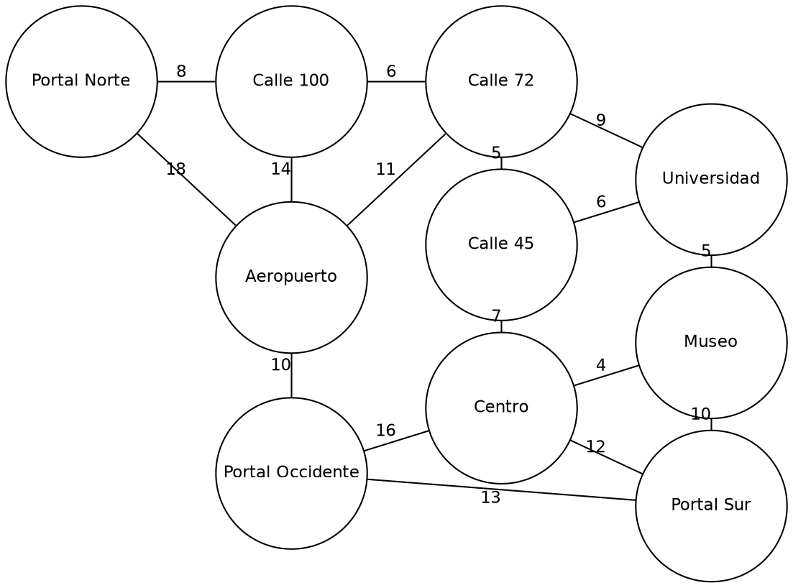

# Guía 12. Introducción a grafos y redes complejas

**Asignatura:** Estructura de Datos II
**Programa:** Ingeniería de Software, Semestre IV
**Estudiante:** Miguel Angel Meneses Arevalo
**Ecosistema:** Java / GitHub

## Dominio elegido: red de transporte

Se modela una red de estaciones de transporte masivo. Cada **vértice** es una estación y cada **arista** es un tramo que une dos estaciones, con un **peso** que es el tiempo de viaje en minutos (valores de ejemplo).

## Diagrama



## Tabla de vértices

| # | Vértice | Grado |
|---|---|---|
| 1 | Portal Norte | 2 |
| 2 | Calle 100 | 3 |
| 3 | Calle 72 | 4 |
| 4 | Calle 45 | 3 |
| 5 | Centro | 4 |
| 6 | Museo | 3 |
| 7 | Universidad | 3 |
| 8 | Aeropuerto | 4 |
| 9 | Portal Sur | 3 |
| 10 | Portal Occidente | 3 |

La suma de los grados es 32, que es el doble de las 16 aristas (lema del apretón de manos).

## Tabla de aristas

| # | Origen | Destino | Peso (min) | Dirigida | Ponderada |
|---|---|---|---|---|---|
| 1 | Portal Norte | Calle 100 | 8 | No | Sí |
| 2 | Calle 100 | Calle 72 | 6 | No | Sí |
| 3 | Calle 72 | Calle 45 | 5 | No | Sí |
| 4 | Calle 45 | Centro | 7 | No | Sí |
| 5 | Centro | Portal Sur | 12 | No | Sí |
| 6 | Centro | Museo | 4 | No | Sí |
| 7 | Museo | Universidad | 5 | No | Sí |
| 8 | Universidad | Calle 45 | 6 | No | Sí |
| 9 | Calle 72 | Universidad | 9 | No | Sí |
| 10 | Calle 100 | Aeropuerto | 14 | No | Sí |
| 11 | Aeropuerto | Portal Occidente | 10 | No | Sí |
| 12 | Portal Occidente | Centro | 16 | No | Sí |
| 13 | Portal Occidente | Portal Sur | 13 | No | Sí |
| 14 | Aeropuerto | Calle 72 | 11 | No | Sí |
| 15 | Museo | Portal Sur | 10 | No | Sí |
| 16 | Portal Norte | Aeropuerto | 18 | No | Sí |

## Clasificación formal

G = (V, A) con |V| = 10 y |A| = 16.

- **No dirigido:** todos los tramos se pueden recorrer en ambos sentidos, así que cada arista es un par no ordenado {u, v}.
- **Ponderado:** cada arista tiene un peso, el tiempo de viaje en minutos.
- **Conexo:** desde cualquier estación se puede llegar a cualquier otra (comprobado con un recorrido en anchura desde Portal Norte, que alcanza las 10 estaciones).
- **Cíclico:** existen caminos cerrados, por ejemplo Centro → Museo → Universidad → Calle 45 → Centro.
- **Disperso:** la densidad es 16 / 45 = 0,356, menor a 0,5. Un grafo no dirigido de 10 vértices podría tener como máximo 10·9/2 = 45 aristas y este solo tiene 16.

## Modelo Java

| Archivo | Descripción |
|---|---|
| `Vertice.java` | Guarda el nombre de la estación. |
| `Arista.java` | Origen, destino, peso y si es dirigida (código base de la guía). |
| `Grafo.java` | Listas de vértices y aristas; calcula grado, conexidad, densidad, ciclo y versión dirigida. |
| `Main.java` | Construye el grafo y muestra las tablas y la clasificación. |
| `salida_consola.txt` | Salida real de la ejecución. |

Ejecutar:

```
javac *.java
java Main
```

## Ejercicios

### 1. Convertir el grafo no dirigido en dirigido

Se convirtió cada arista {u, v} en un arco u → v (método `aDirigido()`), conservando el orden en que se escribió cada tramo.

**Cambio semántico:** en el grafo no dirigido la arista significa "las dos estaciones están conectadas y se puede ir y volver". En el dirigido significa "solo se puede ir del origen al destino". El grafo deja de ser simétrico y aparece la **alcanzabilidad**: llegar de A a B ya no implica poder volver.

Resultado de la ejecución sobre la versión dirigida:

- Desde Portal Norte se llega a 10 de 10 estaciones.
- Desde Portal Occidente se llega a 6 de 10 estaciones.
- Desde Portal Sur se llega a 1 de 10 estaciones (no tiene ningún arco de salida).

Por eso el grafo dirigido ya **no es fuertemente conexo**: hay estaciones desde las que no se puede llegar a las demás. Para conservar los viajes de ida y vuelta habría que usar dos arcos por tramo, 32 en total.

### 2. Identificar un ciclo

Sí existe. Ciclo de 4 aristas: **Centro → Museo → Universidad → Calle 45 → Centro**, con pesos 4 + 5 + 6 + 7 = 22 minutos. Las aristas usadas son la 6, 7, 8 y 4 de la tabla. El programa también encontró otro ciclo más largo: Calle 100 → Calle 72 → Calle 45 → Centro → Portal Sur → Portal Occidente → Aeropuerto → Calle 100.

### 3. ¿Denso o disperso?

**Disperso.** La densidad es 16 / 45 = 0,356. En una red de transporte esto es lo normal: no hay línea directa entre todas las estaciones, solo entre las cercanas o las más importantes. Además el grado promedio es 3,2 (32 / 10), muy lejos de 9, que sería el grado de un grafo completo con 10 vértices.
